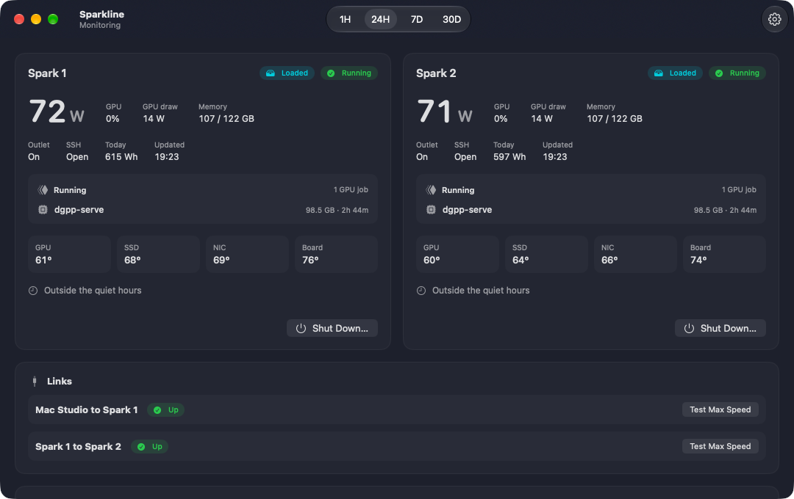
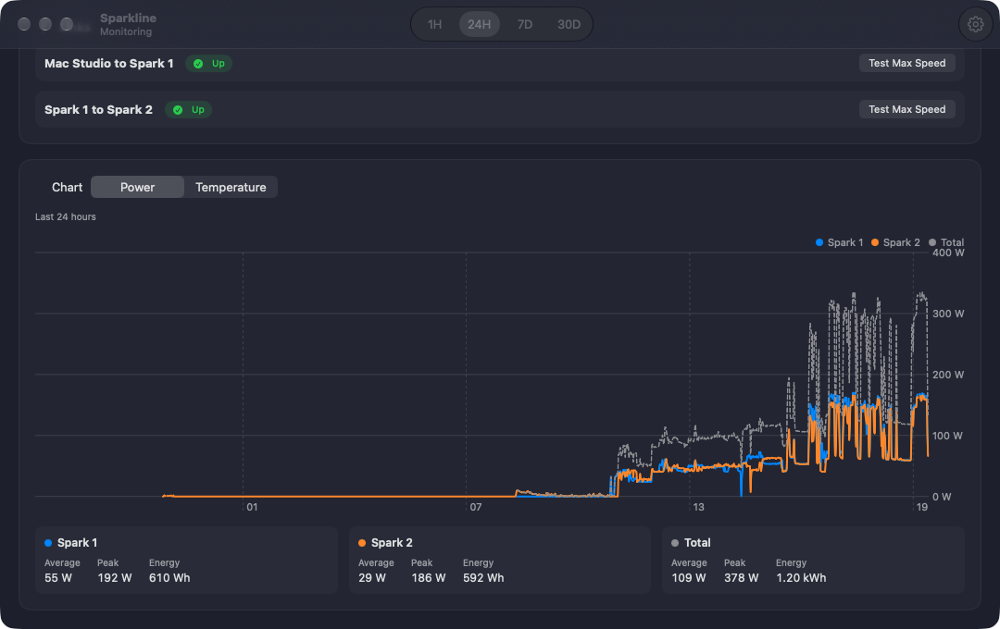
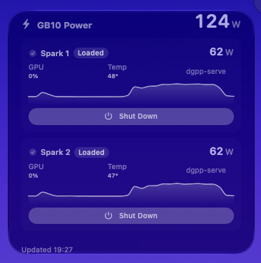

# Sparkline

Menu-bar app for two DGX Sparks, each powered through a Tapo P110.



Each Spark shows whether the outlet is on, whether the machine is up, live watts, GPU use, memory, the job that is running, and temperatures. The link rows show whether the cable to Spark 1 and the cable between the two Sparks are up, and can run a 10-second speed test.



Power and temperature history for the last hour, 24 hours, 7 days, or 30 days. Readings are taken every 10 seconds and kept for a day, with one-minute averages kept for 30 days.



The desktop widget shows both Sparks. Shut Down signs in over SSH and switches the plug off only after the machine is confirmed down. If that check fails, the plug stays on.

## Schedule

Each Spark has its own window in Settings → Schedule. The default is 23:00–07:00, and a window can run past midnight. Inside that window, the Spark shuts down only after it has been idle for the full idle time, 10 minutes unless you change it.

Idle means the GPU is under 10%, `nvidia-smi` shows no compute process, and Docker shows no running container. A process or container that is still loaded, even with the GPU at 0%, keeps the machine on. The idle clock resets as soon as any of that comes back. Temperature never shuts a machine down.

The automatic shutdown uses the same path as the button: SSH first, and the plug switches off only after the machine is confirmed down. A failed attempt waits 10 minutes and tries again. It never cuts power when SSH fails.

Outside the window, the schedule does nothing on its own. **Keep off until turned on** is on by default, so the Spark stays off after the window ends until you press Turn On. If you turn that off, it switches the Spark on when the window ends, but only if the Spark was off during the window.

Pressing Turn On during the window keeps that Spark on until the window ends. Allow Schedule clears that hold. Shut Down still works immediately, even while a job is running.

## Build

Uses the Xcode at `/Applications/Xcode.app`.

```
make install
```

The app lives in the menu bar. Open the dashboard from there, and Settings with ⌘,.
